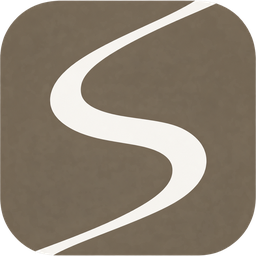
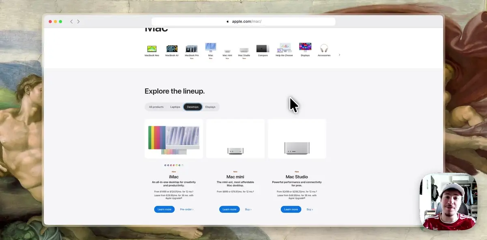

<p align="center">
  <a href="https://screenix.studio/chrome"></a>
</p>

<h1 align="center">Screenix for Chrome</h1>

<p align="center">The open-source Screen Studio alternative for Chrome. Smooth cursor, auto zoom and your camera, on any computer that runs Chrome.</p>

<p align="center">
  <a href="https://chromewebstore.google.com/detail/screenix-for-chrome/daodleelbenbcdllpfecilgeldnncemp">Add to Chrome</a> |
  <a href="https://screenix.studio/chrome">Website</a> |
  <a href="https://screenix.studio/chrome/pricing">Pricing</a> |
  <a href="#build-and-load-it-unpacked">Build from source</a>
</p>

<p align="center">
  <a href="https://chromewebstore.google.com/detail/screenix-for-chrome/daodleelbenbcdllpfecilgeldnncemp"></a>
  <a href="LICENSE"></a>
</p>

<p align="center">
  <a href="https://screenix.studio/chrome"></a>
</p>

Screenix for Chrome records a tab without the system cursor, then redraws a smooth cursor, zooms on your clicks and adds your camera, a background and a browser frame. Everything is rendered and encoded in your browser, and your recordings never leave it unless you create a share link. It is the browser companion to the [Screenix](https://screenix.studio) desktop app and records browser tabs only, not your desktop or other apps.

## Features

- **No system cursor in the recording.** Capture uses the Chrome DevTools screencast, which only contains page pixels. The pointer is tracked separately and redrawn in the editor.
- **Smooth cursor.** Spring-smoothed motion, motion blur, sway, click and drag feedback, idle hiding, and a set of cursor themes at any size.
- **Zoom on clicks.** Auto zoom follows your clicks, or place manual zoom regions on the timeline.
- **Camera, microphone and tab audio.** Record your voice and webcam with the tab. The camera bubble can be placed and styled in the editor or shown on the page while you record.
- **Two modes.** Studio opens the recording in a full editor: backgrounds, browser frame, crop, aspect ratios, trims, cuts, speed clips and click sounds. Instant renders the polished video while you record, so it is ready the moment you stop.
- **Local export up to 4K.** MP4 (H.264) or WebM (VP9), at 30, 60 or 120 fps, encoded with WebCodecs on your machine. Recordings stay in the browser's storage until you export or share them.
- **Follows you across tabs.** Switch tabs or navigate while recording and the recording follows the active tab of the window you started in.

Because capture uses the debugger API, Chrome shows a "started debugging this browser" bar while recording. Pages Chrome protects (`chrome://` pages, the Web Store) can't be recorded.

## How it works

| Piece | Where |
|---|---|
| Capture | `src/background/` attaches the Chrome DevTools Protocol to the active tab and runs `Page.startScreencast`. Frames are written to IndexedDB as they arrive. |
| Pointer tracking | `src/content/` records pointer position, buttons and the CSS cursor shape under the pointer. |
| Microphone and camera | `src/offscreen/` captures media in an offscreen document. |
| Cursor | `src/render/cursor/` builds a spring-smoothed cursor timeline and draws it with its effects. |
| Rendering | `src/render/compositor.ts` draws one output frame. Preview, export and Instant mode all use it. |
| Export | `src/export/` renders frame by frame, encodes with WebCodecs and muxes with `mp4-muxer` / `webm-muxer`. |
| Instant mode | `src/instant/` renders and encodes in a worker while you record. |

## Build and load it unpacked

Requires [Bun](https://bun.sh) and Chrome 118 or later.

```bash
bun install
bun run build
```

Open `chrome://extensions`, turn on Developer mode, click **Load unpacked** and select the `dist` folder. After a rebuild, press the reload button on the extension card.

Checks:

```bash
bun test
bun run lint
bun run typecheck
bun run test:e2e
```

`test:e2e` builds the extension, loads it into a temporary headless Chrome and records a short session in both modes. Set `CHROME_PATH` to use a specific Chrome binary.

## License

Screenix for Chrome is open source under the [GNU Affero General Public License v3.0](LICENSE). You can read, build, change and share the code under its terms. If you distribute a modified version, you must release its source under the AGPLv3 as well.

The Screenix build on the Chrome Web Store is free for personal use. Exports carry a small Screenix watermark until a license key is entered. Commercial use (client work, product demos, courses, anything done for a business) needs a paid [Screenix license](https://screenix.studio/chrome/pricing), which also removes the watermark.

If you want to use the code in a product without the AGPLv3's obligations, write to [mathis@screenix.studio](mailto:mathis@screenix.studio) about a commercial license.

The Screenix brand assets and third-party components are excluded from the AGPLv3. See [NOTICE.md](NOTICE.md).

## Trademark

"Screenix", the Screenix logo, the extension icons and the watermark are trademarks of Screenix. The AGPLv3 does not grant any rights to them.

You can fork and modify the code, but a fork you publish (on the Chrome Web Store, another extension store, or anywhere else) must use its own name, logo and icons, and must not suggest that it is made or endorsed by Screenix. Referring to Screenix to describe where your fork comes from ("based on Screenix for Chrome") is fine.

## Contributing

Bug reports, fixes and improvements are welcome. Read [CONTRIBUTING.md](CONTRIBUTING.md) first. Every contributor signs the [Contributor License Agreement](CLA.md) once, from the pull request.

## Security

Please report vulnerabilities privately. See [SECURITY.md](SECURITY.md).

## On Linux? Record your whole desktop

Screenix for Chrome records browser tabs only. To record your whole screen or any app, [Screenix](https://screenix.studio) is the desktop app for Linux, with the same smooth cursor, auto zoom and camera.

```bash
curl -fsSL screenix.studio/install | sh
```

The installer detects your distro and installs the right package (.deb, .rpm, AUR or Nix). Packages and release notes are in [screenix-releases](https://github.com/mathisdev7/screenix-releases).
